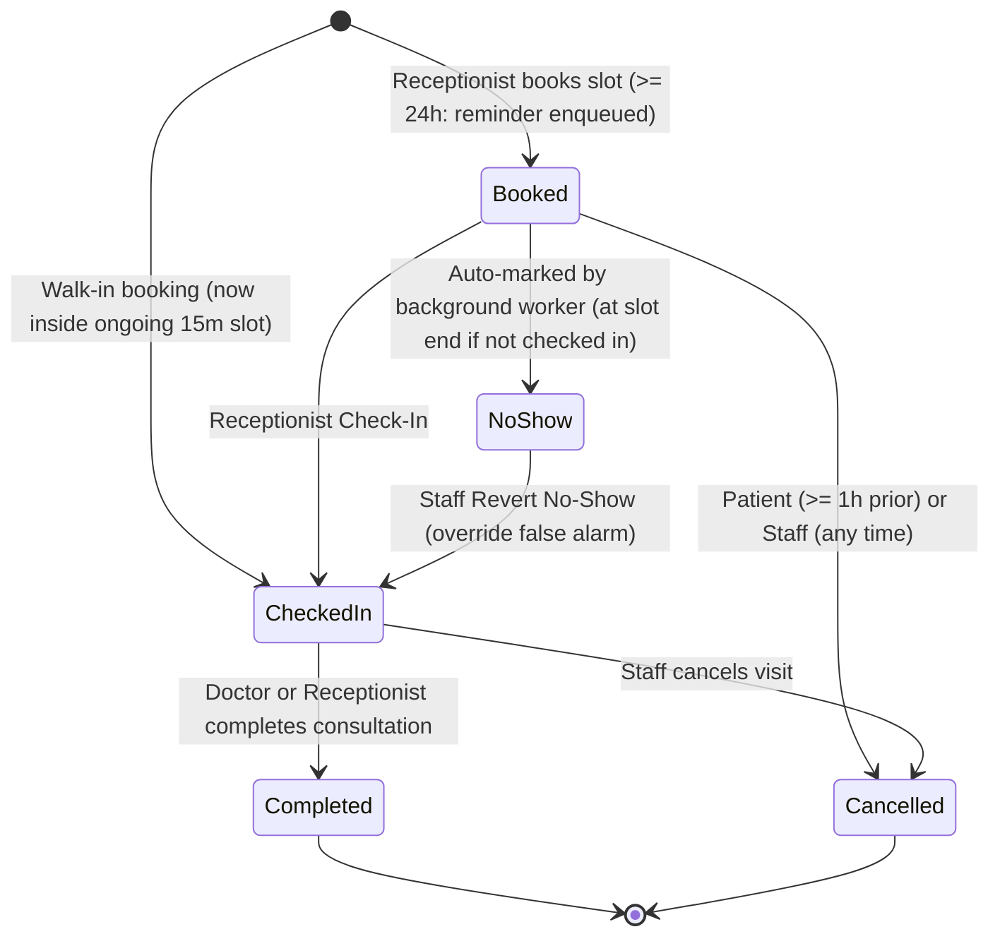
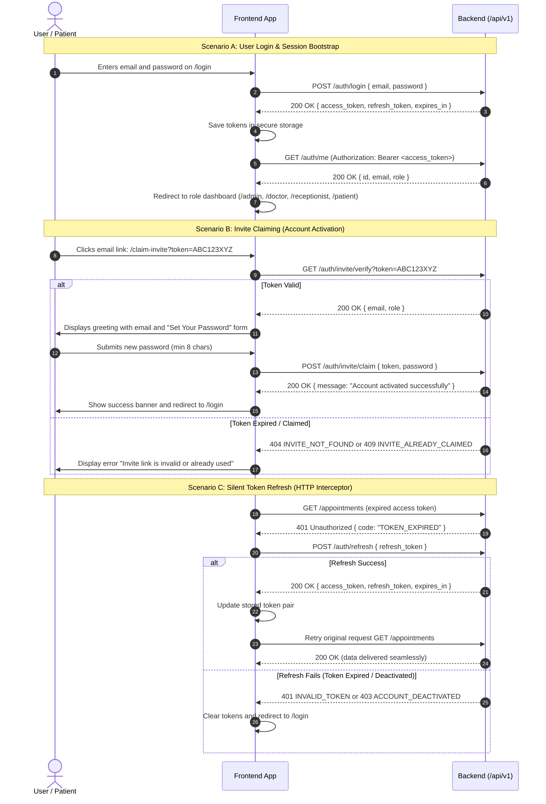
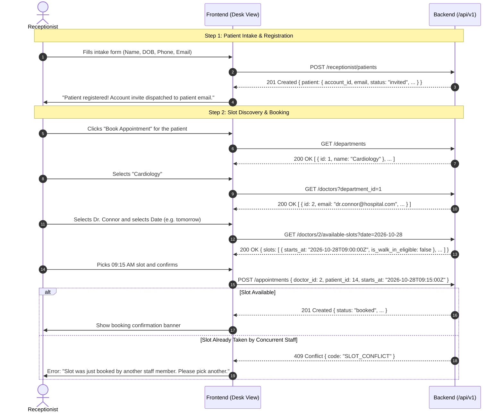
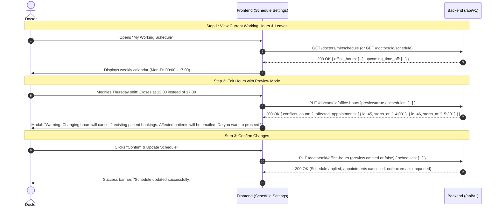
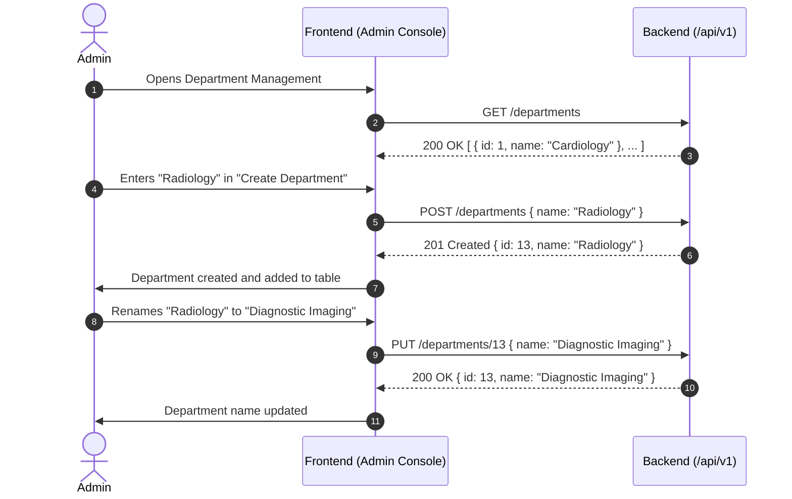

# Hospital Management System (HMS) — Frontend Integration Specification

This document provides a comprehensive technical specification of the backend API as implemented in the codebase. It contains all contracts, data types, authentication mechanisms, business rules, lifecycle state machines, and error schemas required for an agent or developer to build a fully functioning frontend.

---

## 1. System Architecture & Communication Standards

### 1.1 Base URL & Environment
- **Default Base URL:** `http://localhost:8080/api/v1`
- **Default Server Port:** `8080` (configured via `PORT` environment variable)
- **Health Check Endpoint:** `GET http://localhost:8080/health` (returns `{ "status": "ok" }`)

> [!NOTE]
> **CORS & Dev Proxy Configuration:**  
> The backend currently uses standard Gin routing without an explicit CORS middleware. For local frontend development (e.g., Vite, Next.js, or Create React App running on `http://localhost:3000` or `5173`), configure a dev server reverse proxy forwarding `/api` and `/health` to `http://localhost:8080` to avoid browser CORS restrictions.

---

### 1.2 Universal Response Envelope
Every endpoint under `/api/v1` returns a uniform JSON envelope (`response.APIResponse`).

#### Success Response Envelope (`HTTP 200`, `201`)
```json
{
  "success": true,
  "data": { ... }
}
```

#### Error Response Envelope (`HTTP 400`, `401`, `403`, `404`, `409`, `422`, `500`)
```json
{
  "success": false,
  "error": {
    "code": "SLOT_CONFLICT",
    "message": "The selected time slot has already been booked"
  }
}
```

---

### 1.3 Authentication & Session Management
- **Token Mechanism:** Stateless JSON Web Tokens (HMAC-SHA256).
- **Authorization Header:** All protected endpoints require:
  ```http
  Authorization: Bearer <access_token>
  ```
- **Token TTLs:**
  - **Access Token:** `15 minutes` (contains `user_id`, `email`, `role`, and standard JWT claims).
  - **Refresh Token:** `7 days` (used to request a new token pair).
  - **Invite Token:** `48 hours` (cryptographic hex token sent via email to activate new accounts).

#### Recommended Frontend Interceptor Strategy
1. Store `access_token` and `refresh_token` in memory / secure storage.
2. In your HTTP client (e.g., Axios / Fetch interceptor):
   - On receiving HTTP `401` with error code `TOKEN_EXPIRED`, transparently call `POST /api/v1/auth/refresh` with `{ "refresh_token": "..." }`.
   - Update stored tokens and retry the original request.
   - If refresh fails (`INVALID_TOKEN` or `ACCOUNT_DEACTIVATED`), clear tokens and redirect to `/login`.

---

### 1.4 Roles & RBAC Matrix
The system defines four distinct user roles (`domain.Role`):
1. `admin`: Hospital management, department CRUD, doctor schedule administration.
2. `doctor`: Clinical practitioner; manages own weekly office hours and time-off, reviews assigned appointments, completes consultations.
3. `receptionist`: Front-desk operator; registers patients, searches patients, books 15-minute appointment slots, executes arrival check-ins, reverts no-shows. *(Note: Patients cannot self-book; all bookings are handled by receptionists).*
4. `patient`: End user; views own demographic profile, views own appointments, cancels appointments (up to 1 hour prior).

#### Role-Based Endpoint Access Matrix

| Category | Endpoint | Allowed Roles |
| :--- | :--- | :--- |
| **Auth** | `POST /auth/login`, `POST /auth/refresh`, `GET /auth/invite/verify`, `POST /auth/invite/claim` | Public |
| **Auth** | `POST /auth/logout`, `GET /auth/me` | Authenticated (All Roles) |
| **Departments** | `GET /departments` | `admin`, `receptionist`, `doctor` |
| **Departments** | `POST /departments`, `PUT /departments/:id` | `admin` |
| **Patients** | `POST /receptionist/patients` | `receptionist` |
| **Patients** | `GET /patients` | `receptionist`, `doctor`, `admin` |
| **Patients** | `GET /patients/:id` | `admin`, `patient` (self only), `doctor` |
| **Patients** | `PUT /patients/:id` | `receptionist`, `patient` (self only) |
| **Doctors** | `GET /doctors`, `GET /doctors/:id/schedule` | Authenticated (All Roles) |
| **Doctors** | `GET /doctors/:id/available-slots` | `receptionist`, `doctor`, `patient`, `admin` |
| **Doctors** | `PUT /doctors/:id/office-hours`, `POST /doctors/:id/time-off` | `doctor` (self only), `admin` (any doctor) |
| **Appointments** | `POST /appointments` | `receptionist` |
| **Appointments** | `GET /appointments`, `GET /appointments/:id`, `GET /appointments/:id/history` | Authenticated (Scoped by role) |
| **Appointments** | `POST /appointments/:id/check-in` | `receptionist` |
| **Appointments** | `POST /appointments/:id/complete` | `doctor` (assigned only), `receptionist`, `admin` |
| **Appointments** | `POST /appointments/:id/cancel` | `patient` (self, >= 1h prior), `doctor` (assigned), `receptionist`, `admin` |
| **Appointments** | `POST /appointments/:id/revert-no-show` | `receptionist`, `doctor` (assigned), `admin` |

---

### 1.5 Date, Time, and Formatting Standards
- **Timestamps:** ISO 8601 / RFC3339 format in UTC (e.g., `2026-10-28T09:00:00Z`).
- **Date of Birth & Calendar Dates:** `YYYY-MM-DD` (e.g., `1990-05-14`).
- **Office Hour Time Strings:** `HH:MM` in 24-hour format (e.g., `"09:00"`, `"17:00"`).
- **Weekdays:** Integer `0` through `6` matching Go's standard (`0` = Sunday, `1` = Monday, ..., `6` = Saturday).
- **Slot Granularity:** Exactly **15 minutes**. Slot minute boundaries must be multiples of 15 (`:00`, `:15`, `:30`, `:45`).

---

## 2. Complete Endpoint Reference

---

### 2.1 Authentication & Profile (`/api/v1/auth`)

#### 1. Login
- **Method:** `POST`
- **Path:** `/api/v1/auth/login`
- **Access:** Public
- **Request Body:**
  ```json
  {
    "email": "user@hospital.com",
    "password": "Password123!"
  }
  ```
  - `email` (string, required, valid email format)
  - `password` (string, required)
- **Success Response (`200 OK`):**
  ```json
  {
    "success": true,
    "data": {
      "access_token": "eyJhbGciOiJIUzI1NiIsInR5cCI6IkpXVCJ9...",
      "refresh_token": "eyJhbGciOiJIUzI1NiIsInR5cCI6IkpXVCJ9...",
      "expires_in": 900
    }
  }
  ```
- **Error Codes:**
  - `400 BAD_REQUEST`: Missing email or password.
  - `401 INVALID_CREDENTIALS`: Incorrect email or password, or unactivated account.
  - `403 ACCOUNT_DEACTIVATED`: Account has been deactivated.

---

#### 2. Refresh Token
- **Method:** `POST`
- **Path:** `/api/v1/auth/refresh`
- **Access:** Public
- **Request Body:**
  ```json
  {
    "refresh_token": "eyJhbGciOiJIUzI1NiIsInR5cCI6IkpXVCJ9..."
  }
  ```
  - `refresh_token` (string, required)
- **Success Response (`200 OK`):**
  ```json
  {
    "success": true,
    "data": {
      "access_token": "new_jwt_access_token...",
      "refresh_token": "new_jwt_refresh_token...",
      "expires_in": 900
    }
  }
  ```
- **Error Codes:**
  - `400 BAD_REQUEST`: Missing refresh token.
  - `401 INVALID_TOKEN`: Token expired, tampered with, or invalid.
  - `403 ACCOUNT_DEACTIVATED`: User account is deactivated.

---

#### 3. Verify Invite Token
Used by the frontend invite onboarding page when a user opens an email link (e.g., `/claim-invite?token=<token>`).
- **Method:** `GET`
- **Path:** `/api/v1/auth/invite/verify`
- **Access:** Public
- **Query Parameters:**
  - `token` (string, required): The raw hex token from the invite URL.
- **Success Response (`200 OK`):**
  ```json
  {
    "success": true,
    "data": {
      "email": "alice.smith@example.com",
      "role": "patient"
    }
  }
  ```
- **Error Codes:**
  - `400 BAD_REQUEST`: Token query parameter is missing.
  - `404 INVITE_NOT_FOUND`: Token does not exist or has expired (> 48h).
  - `409 INVITE_ALREADY_CLAIMED`: Invite has already been used.

---

#### 4. Claim Invite & Set Password
Activates an invited user account by establishing their initial password.
- **Method:** `POST`
- **Path:** `/api/v1/auth/invite/claim`
- **Access:** Public
- **Request Body:**
  ```json
  {
    "token": "raw_hex_invite_token_string",
    "password": "NewSecurePassword123!"
  }
  ```
  - `token` (string, required)
  - `password` (string, required, minimum 8 characters)
- **Success Response (`200 OK`):**
  ```json
  {
    "success": true,
    "data": {
      "message": "Account activated successfully"
    }
  }
  ```
- **Error Codes:**
  - `400 BAD_REQUEST`: Password shorter than 8 chars or missing token.
  - `404 INVITE_NOT_FOUND`: Invalid or expired invite token.
  - `409 INVITE_ALREADY_CLAIMED`: Invite already claimed.

---

#### 5. Logout
- **Method:** `POST`
- **Path:** `/api/v1/auth/logout`
- **Access:** Authenticated (requires `Bearer <access_token>`)
- **Success Response (`200 OK`):**
  ```json
  {
    "success": true,
    "data": {
      "message": "Logged Out Successfully"
    }
  }
  ```

---

#### 6. Get Current User (`Me`)
Returns the authenticated identity from context.
- **Method:** `GET`
- **Path:** `/api/v1/auth/me`
- **Access:** Authenticated
- **Success Response (`200 OK`):**
  ```json
  {
    "success": true,
    "data": {
      "id": 1,
      "email": "admin@hospital.com",
      "role": "admin"
    }
  }
  ```
- **Error Codes:**
  - `401 UNAUTHORIZED`: Missing or invalid Bearer token.

---

### 2.2 Department Management (`/api/v1/departments`)

#### 1. List Departments
- **Method:** `GET`
- **Path:** `/api/v1/departments`
- **Access:** `admin`, `receptionist`, `doctor`
- **Success Response (`200 OK`):**
  ```json
  {
    "success": true,
    "data": [
      { "id": 1, "name": "Cardiology" },
      { "id": 2, "name": "Neurology" },
      { "id": 3, "name": "Orthopedics" }
    ]
  }
  ```

---

#### 2. Create Department
- **Method:** `POST`
- **Path:** `/api/v1/departments`
- **Access:** `admin` only
- **Request Body:**
  ```json
  {
    "name": "Dermatology"
  }
  ```
  - `name` (string, required, 2 to 100 characters)
- **Success Response (`201 Created`):**
  ```json
  {
    "success": true,
    "data": {
      "id": 13,
      "name": "Dermatology"
    }
  }
  ```
- **Error Codes:**
  - `400 BAD_REQUEST`: Length validation failed.
  - `409 DEPARTMENT_NAME_TAKEN`: A department with this name already exists.

---

#### 3. Update Department
- **Method:** `PUT`
- **Path:** `/api/v1/departments/:id`
- **Access:** `admin` only
- **Path Parameters:**
  - `id` (integer, required): Department ID
- **Request Body:**
  ```json
  {
    "name": "Cardiology & Vascular Surgery"
  }
  ```
- **Success Response (`200 OK`):**
  ```json
  {
    "success": true,
    "data": {
      "id": 1,
      "name": "Cardiology & Vascular Surgery"
    }
  }
  ```
- **Error Codes:**
  - `404 DEPARTMENT_NOT_FOUND`: Department ID does not exist.
  - `409 DEPARTMENT_NAME_TAKEN`: Name conflicts with another existing department.

---

### 2.3 Patient Management (`/api/v1/patients` & `/api/v1/receptionist`)

#### 1. Register Patient Intake
Creates patient account in `invited` state, persists demographic details, generates a 48h invite token, enqueues an `account_invite` email in the transactional outbox, and writes an audit log.
- **Method:** `POST`
- **Path:** `/api/v1/receptionist/patients`
- **Access:** `receptionist` only
- **Request Body:**
  ```json
  {
    "email": "sarah.parker@example.com",
    "first_name": "Sarah",
    "last_name": "Parker",
    "date_of_birth": "1994-08-12",
    "phone_number": "5551234567",
    "gender": "Female",
    "address": "456 Oak Avenue, Apt 2B"
  }
  ```
  - `email` (string, required): Used for invites and reminder notifications.
  - `first_name` (string, required, 1 to 100 chars)
  - `last_name` (string, required, 1 to 100 chars)
  - `date_of_birth` (string, required, `YYYY-MM-DD`, must be strictly in the past)
  - `phone_number` (string, required, length 10 to 12 chars)
  - `gender` (string, optional)
  - `address` (string, optional)
- **Success Response (`201 Created`):**
  ```json
  {
    "success": true,
    "data": {
      "patient": {
        "account_id": 14,
        "email": "sarah.parker@example.com",
        "role": "patient",
        "status": "invited",
        "first_name": "Sarah",
        "last_name": "Parker",
        "date_of_birth": "1994-08-12",
        "phone_number": "5551234567",
        "gender": "Female",
        "address": "456 Oak Avenue, Apt 2B",
        "created_at": "2026-10-27T14:30:00Z",
        "updated_at": "2026-10-27T14:30:00Z"
      }
    }
  }
  ```
- **Error Codes:**
  - `400 BAD_REQUEST`: Missing required fields.
  - `400 INVALID_DATE_OF_BIRTH`: Future date or malformed date.
  - `409 EMAIL_ALREADY_EXISTS`: An account with this email already exists.

---

#### 2. Search Patients
Staff directory search supporting fast lookup by name or phone number with pagination.
- **Method:** `GET`
- **Path:** `/api/v1/patients`
- **Access:** `receptionist`, `doctor`, `admin` (Patients receive `403 FORBIDDEN`)
- **Query Parameters:**
  - `query` (string, optional): Search keyword matched against name or phone number.
  - `page` (integer, optional, default: `1`, min: `1`)
  - `limit` (integer, optional, default: `20`, max: `100`)
- **Success Response (`200 OK`):**
  ```json
  {
    "success": true,
    "data": {
      "patients": [
        {
          "account_id": 10,
          "email": "alice.smith@example.com",
          "role": "patient",
          "status": "active",
          "first_name": "Alice",
          "last_name": "Smith",
          "date_of_birth": "1990-05-14",
          "phone_number": "+1-555-0101",
          "gender": "Female",
          "address": "742 Evergreen Terrace, Springfield",
          "created_at": "2026-10-26T18:00:00Z",
          "updated_at": "2026-10-26T18:00:00Z"
        }
      ],
      "total_count": 1,
      "page": 1,
      "limit": 20,
      "total_pages": 1
    }
  }
  ```

---

#### 3. Get Patient by ID
- **Method:** `GET`
- **Path:** `/api/v1/patients/:id`
- **Access:** `admin`, `doctor`, `patient` (Patient can **only** access their own `account_id`)
- **Path Parameters:**
  - `id` (integer, required): Patient's `account_id`
- **Privacy & Audit Behavior:**
  - If a `doctor` views patient demographics, an audit log entry (`patient_demographics_viewed`) is automatically recorded.
- **Success Response (`200 OK`):**
  ```json
  {
    "success": true,
    "data": {
      "account_id": 10,
      "email": "alice.smith@example.com",
      "role": "patient",
      "status": "active",
      "first_name": "Alice",
      "last_name": "Smith",
      "date_of_birth": "1990-05-14",
      "phone_number": "+1-555-0101",
      "gender": "Female",
      "address": "742 Evergreen Terrace, Springfield",
      "created_at": "2026-10-26T18:00:00Z",
      "updated_at": "2026-10-26T18:00:00Z"
    }
  }
  ```
- **Error Codes:**
  - `400 INVALID_ID`: ID is not an integer.
  - `403 FORBIDDEN`: Patient attempted to view another patient's data.
  - `404 PATIENT_NOT_FOUND`: Record does not exist.

---

#### 4. Update Patient Demographics
- **Method:** `PUT`
- **Path:** `/api/v1/patients/:id`
- **Access:** `receptionist`, `patient` (Patient can **only** edit own profile)
- **Request Body:**
  ```json
  {
    "first_name": "Alice",
    "last_name": "Smith",
    "date_of_birth": "1990-05-14",
    "phone_number": "+1-555-9999",
    "gender": "Female",
    "address": "Updated Street Address, City"
  }
  ```
  - `first_name`, `last_name` (string, required, 1-100 chars)
  - `date_of_birth` (string, required, `YYYY-MM-DD`, in the past)
  - `phone_number` (string, required, 7-30 chars)
  - `gender`, `address` (string, optional)
- **Success Response (`200 OK`):** Returns updated patient demographic object.
- **Error Codes:**
  - `400 INVALID_DATE_OF_BIRTH`: Date format error or future date.
  - `403 FORBIDDEN`: Patient attempting to update someone else.
  - `404 PATIENT_NOT_FOUND`: Patient ID not found.

---

### 2.4 Doctor Directory & Schedule Management (`/api/v1/doctors`)

#### 1. List Active Doctors
- **Method:** `GET`
- **Path:** `/api/v1/doctors`
- **Access:** Authenticated (All Roles)
- **Query Parameters:**
  - `department_id` (integer, optional): Filter doctors by clinical department.
- **Success Response (`200 OK`):**
  ```json
  {
    "success": true,
    "data": [
      {
        "id": 2,
        "email": "dr.sarah.connor@hospital.com",
        "department_id": 1,
        "department_name": "Cardiology",
        "created_at": "2026-10-26T18:00:00Z"
      }
    ]
  }
  ```

---

#### 2. Get Doctor Schedule & Upcoming Leaves
Retrieves recurring weekly working hours and upcoming scheduled time-off for a doctor.
- **Method:** `GET`
- **Path:** `/api/v1/doctors/:id/schedule`
- **Access:** Authenticated (All Roles)
- **Path Parameters:**
  - `id` (integer, required): Doctor's `account_id`
- **Success Response (`200 OK`):**
  ```json
  {
    "success": true,
    "data": {
      "doctor_id": 2,
      "office_hours": [
        {
          "id": 1,
          "doctor_id": 2,
          "weekday": 1,
          "start_time": "09:00",
          "end_time": "17:00"
        },
        {
          "id": 2,
          "doctor_id": 2,
          "weekday": 3,
          "start_time": "10:00",
          "end_time": "16:00"
        }
      ],
      "upcoming_time_off": [
        {
          "id": 1,
          "doctor_id": 2,
          "starts_at": "2026-11-01T00:00:00Z",
          "ends_at": "2026-11-03T00:00:00Z",
          "reason": "Annual Medical Conference"
        }
      ]
    }
  }
  ```
- **Error Codes:**
  - `404 DOCTOR_NOT_FOUND`: Doctor does not exist.

---

#### 3. Compute Available 15-Minute Slots
Calculates open, non-conflicting 15-minute booking slots in real time for the upcoming 7 days.
- **Method:** `GET`
- **Path:** `/api/v1/doctors/:id/available-slots`
- **Access:** `receptionist`, `doctor`, `patient`, `admin`
- **Path Parameters:**
  - `id` (integer, required): Doctor's `account_id`
- **Query Parameters:**
  - `date` (string, optional, format: `YYYY-MM-DD`): If provided, calculates slots for that specific day. If omitted, computes all slots across the full 7-day window.
- **Engine Rules & Invariants:**
  1. **7-Day Window:** Slots can only be queried up to 7 days ahead from today (`BOOKING_WINDOW_EXCEEDED`).
  2. **Leaves & Appointments:** Any slot overlapping doctor leave or non-cancelled appointments is omitted.
  3. **Past Exclusions:** Past slots are excluded.
  4. **Walk-In Eligibility:** `is_walk_in_eligible: true` when `current_time` falls directly within that ongoing 15-minute window!
- **Success Response (`200 OK`):**
  ```json
  {
    "success": true,
    "data": {
      "doctor_id": 2,
      "slots": [
        {
          "starts_at": "2026-10-28T09:00:00Z",
          "ends_at": "2026-10-28T09:15:00Z",
          "is_walk_in_eligible": false
        },
        {
          "starts_at": "2026-10-28T09:15:00Z",
          "ends_at": "2026-10-28T09:30:00Z",
          "is_walk_in_eligible": false
        }
      ]
    }
  }
  ```
- **Error Codes:**
  - `400 BOOKING_WINDOW_EXCEEDED`: Date is beyond the 7-day window.
  - `400 DOCTOR_NOT_ACTIVE`: Doctor account is deactivated.
  - `404 DOCTOR_NOT_FOUND`: Doctor ID does not exist.

---

#### 4. Update Recurring Office Hours (with Preview Mode)
Sets the doctor's weekly recurring shift schedule. Replaces existing office hours atomically.
- **Method:** `PUT`
- **Path:** `/api/v1/doctors/:id/office-hours`
- **Access:** `doctor` (can only edit self), `admin` (can edit any doctor)
- **Query Parameters:**
  - `preview` (boolean string, optional, default: `"false"`):
    - When `?preview=true`: Calculates how many already-booked appointments would be invalidated by the change **without applying any changes**. Ideal for UI confirmation dialogs!
    - When `?preview=false` (or omitted): Commits the new schedule, automatically cancels conflicting booked appointments, sets reason to `"doctor_schedule_change"`, enqueues outbox `"slot_removed"` alert emails to affected patients, and writes an audit log.
- **Request Body:**
  ```json
  {
    "schedules": [
      {
        "weekday": 1,
        "intervals": [
          { "start_time": "09:00", "end_time": "12:00" },
          { "start_time": "13:00", "end_time": "17:00" }
        ]
      },
      {
        "weekday": 3,
        "intervals": [
          { "start_time": "10:00", "end_time": "16:00" }
        ]
      }
    ]
  }
  ```
  - `weekday`: Integer `0` to `6` (`0` = Sun, `1` = Mon, ..., `6` = Sat)
  - `start_time` / `end_time`: `HH:MM` (24h format). `start_time` must be strictly before `end_time`.
  - Intervals on the same weekday must not overlap.
- **Success Response (`200 OK`):**
  ```json
  {
    "success": true,
    "data": {
      "conflicts_count": 1,
      "affected_appointments": [
        {
          "id": 14,
          "patient_id": 8,
          "starts_at": "2026-10-29T12:15:00Z",
          "ends_at": "2026-10-29T12:30:00Z"
        }
      ]
    }
  }
  ```
- **Error Codes:**
  - `400 INVALID_WEEKDAY`: Weekday not between 0 and 6.
  - `400 INVALID_TIME_FORMAT`: Not in `HH:MM` format.
  - `400 INVALID_TIME_RANGE`: End time is earlier than or equal to start time.
  - `400 OVERLAPPING_OFFICE_HOURS`: Overlapping shifts on the same day.
  - `403 FORBIDDEN`: Doctor trying to update another doctor's hours.
  - `404 DOCTOR_NOT_FOUND`: Doctor ID does not exist.

---

#### 5. Book Doctor Time-Off / Leave
Schedules a vacation, conference, or emergency blackout window.
- **Method:** `POST`
- **Path:** `/api/v1/doctors/:id/time-off`
- **Access:** `doctor` (self only), `admin` (any doctor)
- **Request Body:**
  ```json
  {
    "starts_at": "2026-11-10T00:00:00Z",
    "ends_at": "2026-11-12T23:59:59Z",
    "reason": "Attending Annual Cardiology Summit"
  }
  ```
  - `starts_at` (RFC3339 timestamp, required)
  - `ends_at` (RFC3339 timestamp, required, must be after `starts_at` and not entirely in the past)
  - `reason` (string, optional)
- **Side Effects:**
  - Automatically cancels all booked appointments falling inside the leave window.
  - Enqueues `slot_removed` notification emails to affected patients.
  - Appends transition events (`booked -> cancelled`, reason: `doctor_schedule_change`).
- **Success Response (`201 Created`):**
  ```json
  {
    "success": true,
    "data": {
      "id": 4,
      "doctor_id": 2,
      "starts_at": "2026-11-10T00:00:00Z",
      "ends_at": "2026-11-12T23:59:59Z",
      "reason": "Attending Annual Cardiology Summit"
    }
  }
  ```
- **Error Codes:**
  - `400 INVALID_TIME_RANGE`: StartsAt is not before EndsAt.
  - `400 TIME_OFF_IN_PAST`: Entire range is in the past.
  - `403 FORBIDDEN`: Doctor trying to book time-off for another doctor.
  - `404 DOCTOR_NOT_FOUND`: Doctor ID does not exist.

---

### 2.5 Appointment Lifecycle Management (`/api/v1/appointments`)

#### 1. Book Appointment
Books a discrete 15-minute consultation.
- **Method:** `POST`
- **Path:** `/api/v1/appointments`
- **Access:** `receptionist` ONLY (patients cannot self-book)
- **Request Body:**
  ```json
  {
    "doctor_id": 2,
    "patient_id": 10,
    "starts_at": "2026-10-29T10:00:00Z"
  }
  ```
  - `doctor_id` (integer, required)
  - `patient_id` (integer, required)
  - `starts_at` (RFC3339 timestamp, required)
- **Engine Invariants & Behaviors:**
  1. **Slot Boundary Alignment:** Must align to 15-minute marks (`:00`, `:15`, `:30`, `:45`) with zero seconds/nanoseconds.
  2. **Booking Window:** Max 7 days in advance.
  3. **Walk-In Handling:** If `starts_at` is in the past but current time is still within that 15-minute slot (`now < ends_at`), this is treated as a walk-in booking: the appointment is created with status **`checked_in`** immediately!
  4. **Working Hours & Leaves:** Rejects bookings outside doctor office hours (`OUTSIDE_OFFICE_HOURS`) or overlapping leave (`DOCTOR_TIME_OFF_CONFLICT`).
  5. **Zero Double-Booking Guarantee:** Protected by a PostgreSQL GiST exclusion lock. Simultaneous concurrent attempts return `SLOT_CONFLICT`.
  6. **Automated Reminders:** If booked $\ge 24$ hours in advance, enqueues an `appointment_reminder` email scheduled for $T - 24\text{h}$.
- **Success Response (`201 Created`):**
  ```json
  {
    "success": true,
    "data": {
      "id": 18,
      "doctor_id": 2,
      "doctor_email": "dr.sarah.connor@hospital.com",
      "department_id": 1,
      "department_name": "Cardiology",
      "patient_id": 10,
      "patient_email": "alice.smith@example.com",
      "patient_first_name": "Alice",
      "patient_last_name": "Smith",
      "starts_at": "2026-10-29T10:00:00Z",
      "ends_at": "2026-10-29T10:15:00Z",
      "status": "booked",
      "cancellation_reason": null,
      "created_at": "2026-10-27T15:00:00Z",
      "updated_at": "2026-10-27T15:00:00Z"
    }
  }
  ```
- **Error Codes:**
  - `400 INVALID_SLOT_DURATION`: Not on a 15-minute boundary.
  - `400 BOOKING_WINDOW_EXCEEDED`: More than 7 days in advance.
  - `400 SLOT_IN_PAST`: Slot has already concluded.
  - `400 DOCTOR_NOT_ACTIVE`: Doctor account is inactive.
  - `404 DOCTOR_NOT_FOUND` / `PATIENT_NOT_FOUND`: Referenced doctor or patient missing.
  - `409 SLOT_CONFLICT`: Slot already taken (GiST exclusion lock triggered).
  - `409 DOCTOR_TIME_OFF_CONFLICT`: Doctor is on leave.
  - `422 OUTSIDE_OFFICE_HOURS`: Outside doctor's working schedule.

---

#### 2. List Appointments (with Scoped Filtering & Pagination)
- **Method:** `GET`
- **Path:** `/api/v1/appointments`
- **Access:** Authenticated (All Roles, automatically scoped)
- **Role Visibility Scoping:**
  - `doctor`: Strictly scoped to appointments where `doctor_id == current_user.id`.
  - `patient`: Strictly scoped to appointments where `patient_id == current_user.id`.
  - `receptionist` & `admin`: Full visibility across all hospital appointments.
- **Query Parameters:**
  - `doctor_id` (integer, optional): Filter by doctor (staff only).
  - `patient_id` (integer, optional): Filter by patient (staff only).
  - `status` (string, optional): One of `booked`, `checked_in`, `completed`, `cancelled`, `no_show`.
  - `from` (string, optional, RFC3339): Appointments starting after this timestamp.
  - `to` (string, optional, RFC3339): Appointments ending before this timestamp.
  - `page` (integer, optional, default: `1`)
  - `limit` (integer, optional, default: `20`, max: `100`)
- **Success Response (`200 OK`):**
  ```json
  {
    "success": true,
    "data": {
      "appointments": [
        {
          "id": 18,
          "doctor_id": 2,
          "doctor_email": "dr.sarah.connor@hospital.com",
          "department_id": 1,
          "department_name": "Cardiology",
          "patient_id": 10,
          "patient_email": "alice.smith@example.com",
          "patient_first_name": "Alice",
          "patient_last_name": "Smith",
          "starts_at": "2026-10-29T10:00:00Z",
          "ends_at": "2026-10-29T10:15:00Z",
          "status": "booked",
          "cancellation_reason": null,
          "created_at": "2026-10-27T15:00:00Z",
          "updated_at": "2026-10-27T15:00:00Z"
        }
      ],
      "total_count": 1,
      "page": 1,
      "limit": 20
    }
  }
  ```

---

#### 3. Get Single Appointment Details
- **Method:** `GET`
- **Path:** `/api/v1/appointments/:id`
- **Access:** Authenticated
- **Scoping Invariant:** Patients can only retrieve their own; doctors can only retrieve appointments assigned to them.
- **Success Response (`200 OK`):** Returns the full `AppointmentDetailResponse` object.
- **Error Codes:**
  - `403 FORBIDDEN`: Accessing an appointment belonging to another user.
  - `404 APPOINTMENT_NOT_FOUND`: Appointment does not exist.

---

#### 4. Patient Check-In
Marks patient arrival at front desk. Moves state: `booked` $\rightarrow$ `checked_in`.
- **Method:** `POST`
- **Path:** `/api/v1/appointments/:id/check-in`
- **Access:** `receptionist` only
- **Success Response (`200 OK`):** Returns updated appointment with `"status": "checked_in"`.
- **Error Codes:**
  - `409 INVALID_STATUS_TRANSITION`: Appointment is not in `booked` status.

---

#### 5. Complete Consultation
Marks consultation finished. Moves state: `checked_in` $\rightarrow$ `completed`.
- **Method:** `POST`
- **Path:** `/api/v1/appointments/:id/complete`
- **Access:** `doctor` (assigned only), `receptionist`, `admin`
- **Success Response (`200 OK`):** Returns updated appointment with `"status": "completed"`.
- **Error Codes:**
  - `403 FORBIDDEN`: Doctor trying to complete another doctor's consultation.
  - `409 INVALID_STATUS_TRANSITION`: Appointment is not in `checked_in` status.

---

#### 6. Cancel Appointment
Cancels a scheduled visit. Moves state: $\rightarrow$ `cancelled`.
- **Method:** `POST`
- **Path:** `/api/v1/appointments/:id/cancel`
- **Access:** `patient`, `doctor`, `receptionist`, `admin`
- **Request Body:**
  ```json
  {
    "reason": "Patient has conflicting work commitment"
  }
  ```
  - `reason` (string, required, 3 to 500 characters)
- **Cancellation Rules & Invariants:**
  1. Completed, already cancelled, or no-show visits cannot be cancelled (`CANNOT_CANCEL_APPOINTMENT`).
  2. **1-Hour Cutoff for Patients:** Patients can only cancel up to **1 hour prior** to `starts_at`. Within 1 hour, patients receive `422 CANCELLATION_CUTOFF_EXCEEDED` (staff must be contacted to cancel).
  3. **Staff Freedom:** Receptionists, doctors, and admins may cancel at any time.
  4. **Outbox Revocation:** Pending reminder emails in the outbox for this appointment are immediately cancelled.
- **Success Response (`200 OK`):** Returns updated appointment with `"status": "cancelled"` and `"cancellation_reason": "..."`.
- **Error Codes:**
  - `403 FORBIDDEN`: Patient or doctor attempting to cancel an appointment not theirs.
  - `409 CANNOT_CANCEL_APPOINTMENT`: Already completed, cancelled, or no-show.
  - `422 CANCELLATION_CUTOFF_EXCEEDED`: Patient attempted cancellation under 1 hour before start.

---

#### 7. Revert No-Show
Reverts an erroneous auto-marked no-show back to checked-in. Moves state: `no_show` $\rightarrow$ `checked_in`.
- **Method:** `POST`
- **Path:** `/api/v1/appointments/:id/revert-no-show`
- **Access:** `receptionist`, `doctor` (assigned), `admin`
- **Success Response (`200 OK`):** Returns updated appointment with `"status": "checked_in"`.
- **Error Codes:**
  - `409 INVALID_STATUS_TRANSITION`: Appointment is not currently in `no_show` status.

---

#### 8. Get Appointment Transition Timeline (`History`)
Returns the audit trail of status transitions for an appointment.
- **Method:** `GET`
- **Path:** `/api/v1/appointments/:id/history`
- **Access:** Authenticated (scoped to authorized users)
- **Success Response (`200 OK`):**
  ```json
  {
    "success": true,
    "data": [
      {
        "id": 1,
        "appointment_id": 18,
        "from_status": null,
        "to_status": "booked",
        "changed_by": 4,
        "changed_by_email": "reception.clara@hospital.com",
        "reason": "scheduled_booking",
        "created_at": "2026-10-27T15:00:00Z"
      },
      {
        "id": 2,
        "appointment_id": 18,
        "from_status": "booked",
        "to_status": "checked_in",
        "changed_by": 4,
        "changed_by_email": "reception.clara@hospital.com",
        "reason": "patient_check_in",
        "created_at": "2026-10-29T09:55:00Z"
      },
      {
        "id": 3,
        "appointment_id": 18,
        "from_status": "checked_in",
        "to_status": "completed",
        "changed_by": 2,
        "changed_by_email": "dr.sarah.connor@hospital.com",
        "reason": "consultation_completed",
        "created_at": "2026-10-29T10:14:00Z"
      }
    ]
  }
  ```

---

## 3. Appointment Lifecycle State Machine

The following diagram illustrates all permitted transitions in the backend:



### Invalidation & Side Effect Rules
- **No-Show:** Triggered automatically by the background worker daemon if the slot concludes (`now > ends_at`) and the patient was never moved to `checked_in`.
- **Cancellation:** Instantly removes any pending reminder emails from the transactional outbox (`notifications` table).
- **Schedule Changes:** When a doctor updates office hours or creates time-off, any overlapping `booked` appointments are automatically cancelled (`reason: doctor_schedule_change`), and a `slot_removed` notification email is dispatched.

---

## 4. Frontend TypeScript Types Reference

The frontend agent can drop these types directly into a `types/api.ts` file:

```typescript
// Roles & Statuses
export type UserRole = 'admin' | 'doctor' | 'patient' | 'receptionist';
export type AccountStatus = 'invited' | 'active' | 'deactivated';
export type AppointmentStatus = 'booked' | 'checked_in' | 'completed' | 'cancelled' | 'no_show';

// Universal Response Envelopes
export interface APIResponse<T> {
  success: boolean;
  data?: T;
  error?: APIError;
}

export interface APIError {
  code: string;
  message: string;
}

// Authentication
export interface TokenPair {
  access_token: string;
  refresh_token: string;
  expires_in: number;
}

export interface MeResponse {
  id: number;
  email: string;
  role: UserRole;
}

export interface InviteVerificationResponse {
  email: string;
  role: UserRole;
}

// Department
export interface Department {
  id: number;
  name: string;
}

// Patient
export interface Patient {
  account_id: number;
  email: string;
  role: UserRole;
  status: AccountStatus;
  first_name: string;
  last_name: string;
  date_of_birth: string; // "YYYY-MM-DD"
  phone_number: string;
  gender?: string | null;
  address?: string | null;
  created_at: string;
  updated_at: string;
}

export interface PaginatedPatientsResponse {
  patients: Patient[];
  total_count: number;
  page: number;
  limit: number;
  total_pages: number;
}

// Doctor & Schedule
export interface DoctorProfile {
  id: number;
  email: string;
  department_id?: number | null;
  department_name?: string | null;
  created_at: string;
}

export interface OfficeHourInterval {
  start_time: string; // "HH:MM"
  end_time: string;   // "HH:MM"
}

export interface WeekdaySchedule {
  weekday: number; // 0 = Sunday, 1 = Monday, ..., 6 = Saturday
  intervals: OfficeHourInterval[];
}

export interface OfficeHourResponse {
  id: number;
  doctor_id: number;
  weekday: number;
  start_time: string;
  end_time: string;
}

export interface TimeOffResponse {
  id: number;
  doctor_id: number;
  starts_at: string;
  ends_at: string;
  reason: string;
}

export interface DoctorScheduleResponse {
  doctor_id: number;
  office_hours: OfficeHourResponse[];
  upcoming_time_off: TimeOffResponse[];
}

export interface Slot {
  starts_at: string;
  ends_at: string;
  is_walk_in_eligible: boolean;
}

export interface DoctorAvailableSlotsResponse {
  doctor_id: number;
  slots: Slot[];
}

export interface AffectedAppointment {
  id: number;
  patient_id: number;
  starts_at: string;
  ends_at: string;
}

export interface UpdateOfficeHoursPreviewResponse {
  conflicts_count: number;
  affected_appointments: AffectedAppointment[];
}

// Appointment
export interface AppointmentDetailResponse {
  id: number;
  doctor_id: number;
  doctor_email: string;
  department_id?: number | null;
  department_name?: string | null;
  patient_id: number;
  patient_email: string;
  patient_first_name?: string | null;
  patient_last_name?: string | null;
  starts_at: string;
  ends_at: string;
  status: AppointmentStatus;
  cancellation_reason?: string | null;
  created_at: string;
  updated_at: string;
}

export interface PaginatedAppointmentsResponse {
  appointments: AppointmentDetailResponse[];
  total_count: number;
  page: number;
  limit: number;
}

export interface AppointmentStatusEventResponse {
  id: number;
  appointment_id: number;
  from_status?: AppointmentStatus | null;
  to_status: AppointmentStatus;
  changed_by?: number | null;
  changed_by_email?: string | null;
  reason?: string | null;
  created_at: string;
}
```

---

## 5. Seeded Test Accounts & Verification Credentials

The backend seed script (`cmd/seed/main.go`) populates the database with realistic test accounts. All pre-seeded accounts share the same password.

- **Universal Seed Password:** `Password123!`

### Pre-Seeded Accounts by Role

| Role | Email | Details |
| :--- | :--- | :--- |
| **Admin** | `admin@hospital.com` | Root Administrator |
| **Receptionist** | `reception.clara@hospital.com` | Front Desk Receptionist (Active) |
| **Receptionist** | `reception.mark@hospital.com` | Front Desk Receptionist (Active) |
| **Doctor** | `dr.sarah.connor@hospital.com` | Cardiology Department |
| **Doctor** | `dr.john.watson@hospital.com` | Neurology Department |
| **Doctor** | `dr.gregory.house@hospital.com` | Orthopedics Department |
| **Doctor** | `dr.meredith.grey@hospital.com` | Pediatrics Department |
| **Patient** | `alice.smith@example.com` | Active Patient Profile |
| **Patient** | `bob.jones@example.com` | Active Patient Profile |
| **Patient** | `charlie.brown@example.com` | Active Patient Profile |

### Test Tokens for Invite Claim Flows
- **Invited Receptionist (Elena):** `receptionist_elena_invite_token_123`
- **Invited Patient (Kevin Bacon):** `patient_invite_token_sample_11_Kevin`

---

## 6. Upcoming Backend Roadmap (Planned Endpoints)

For frontend planning, be aware that the following features exist in the project specifications but are **not yet exposed as active routes** in the Go backend:

1. **Admin Staff Onboarding (`/api/v1/admin/invites`):** Currently, patient intake generates invites (`POST /receptionist/patients`); staff invites by admin are planned for the next sprint.
2. **Admin Account Management (`/api/v1/admin/accounts`, `/deactivate`):** Staff deactivation endpoints.
3. **Clinical Charts & Vitals:** Clinical consultation notes, append-only medical records, and vitals recording (BP, pulse, temp, SpO2) are scheduled for Phase 2. Ensure your frontend design leaves a tab or placeholder for Clinical Records in the patient and doctor views.

---

## 7. End-to-End Feature Walkthroughs & User Journeys

This section details how each front-facing feature is assembled, what views/screens are involved, what sequence of API endpoints must be called, how state flows between them, and how edge cases must be handled in the UI.

---

### Flow 1: Authentication, Onboarding & Session Lifecycle



#### Step-by-Step Implementation Details:
1. **Login Page (`/login`):**
   - Form fields: Email, Password.
   - Endpoint: `POST /api/v1/auth/login`.
   - On success: Store tokens, call `GET /api/v1/auth/me` to get the `role` and `id`, then route:
     - `admin` $\rightarrow$ `/admin/departments`
     - `doctor` $\rightarrow$ `/doctor/appointments`
     - `receptionist` $\rightarrow$ `/receptionist/queue`
     - `patient` $\rightarrow$ `/patient/appointments`
2. **Invite Activation Page (`/claim-invite`):**
   - Parse `?token=...` from the query string.
   - Immediately trigger `GET /api/v1/auth/invite/verify?token=...`.
   - Render a card: "Welcome! Activating account for `{email}` ({role})".
   - When the user enters a password ($\ge 8$ chars) and confirms, send `POST /api/v1/auth/invite/claim`.
3. **Logout Button:**
   - Call `POST /api/v1/auth/logout` with Bearer token.
   - Clear storage and navigate to `/login`.

---

### Flow 2: Receptionist — Patient Intake & Scheduling



#### Step-by-Step Implementation Details:
1. **Patient Intake Form (`/receptionist/patients/new`):**
   - Inputs: First Name, Last Name, Date of Birth (`YYYY-MM-DD`), Phone Number (10-12 digits), Email, Gender, Address.
   - Call `POST /api/v1/receptionist/patients`.
   - On success, patient profile is returned. Offer a one-click button: *"Book appointment for this patient"*, which passes `patient_id` directly into the booking modal.
2. **Patient Directory & Search (`/receptionist/patients`):**
   - Search input box with debounced typing (300ms).
   - Call `GET /api/v1/patients?query=<keyword>&page=1&limit=20`.
   - Table columns: Full Name, DOB, Phone Number, Status (`invited`/`active`), Actions (`Book Visit`, `Edit`).
3. **Appointment Booking Wizard:**
   - **Step 1 (Department):** Call `GET /api/v1/departments` and render cards/select dropdown.
   - **Step 2 (Doctor):** Call `GET /api/v1/doctors?department_id=<selected>` and render available doctors.
   - **Step 3 (Slot Picker):** Date picker bounded to today + 7 days. When date changes, call `GET /api/v1/doctors/:id/available-slots?date=YYYY-MM-DD`. Render green buttons for available 15m slots.
   - **Step 4 (Submit):** Send `POST /api/v1/appointments` with `{ doctor_id, patient_id, starts_at }`.

---

### Flow 3: Receptionist — Walk-Ins, Check-Ins & No-Show Reversions

```mermaid
sequenceDiagram
    autonumber
    actor Rec as Receptionist
    participant UI as Frontend (Queue View)
    participant API as Backend (/api/v1)

    Note over Rec, API: Scenario A: Immediate Walk-In Booking
    Rec->>UI: Selects Doctor for a walk-in patient standing at the counter
    UI->>API: GET /doctors/:id/available-slots
    Note over API, UI: Slot matching current time has is_walk_in_eligible = true
    API-->>UI: 200 OK { slots: [ ..., { starts_at: "10:00", is_walk_in_eligible: true } ] }
    Rec->>UI: Clicks "Book Walk-In Now" on eligible slot
    UI->>API: POST /appointments { doctor_id, patient_id, starts_at }
    API-->>UI: 201 Created { status: "checked_in" }
    UI->>Rec: "Walk-in booked and automatically checked in! Patient is in queue."

    Note over Rec, API: Scenario B: Patient Arrival Check-In
    Rec->>UI: Patient arrives for 11:00 AM booking
    UI->>API: GET /appointments?status=booked
    API-->>UI: 200 OK { appointments: [ { id: 18, patient_name: "Alice", status: "booked" } ] }
    Rec->>UI: Clicks "Check In" button
    UI->>API: POST /appointments/18/check-in
    API-->>UI: 200 OK { id: 18, status: "checked_in" }
    UI->>Rec: Badge updates to "checked_in"

    Note over Rec, API: Scenario C: Revert Erroneous No-Show
    Note over API: Worker automatically marked appointment as no_show at slot end
    Rec->>UI: Patient arrived 5 minutes late; shows in No-Show list
    UI->>API: GET /appointments?status=no_show
    Rec->>UI: Clicks "Revert No-Show"
    UI->>API: POST /appointments/18/revert-no-show
    API-->>UI: 200 OK { id: 18, status: "checked_in" }
    UI->>Rec: Patient moved back into active waiting queue
```

#### Step-by-Step Implementation Details:
1. **Front-Desk Daily Queue View (`/receptionist/queue`):**
   - Filter tabs: `Booked (Arriving)`, `Checked-In (Waiting)`, `No-Show`, `Completed`.
   - Call `GET /api/v1/appointments?from=<today_00:00>&to=<today_23:59>&status=<tab>`.
2. **Action Buttons in Queue Rows:**
   - When row has `status === 'booked'`: Render primary button **"Check In"** $\rightarrow$ calls `POST /api/v1/appointments/:id/check-in`.
   - When row has `status === 'no_show'`: Render warning button **"Revert No-Show"** $\rightarrow$ calls `POST /api/v1/appointments/:id/revert-no-show`.
   - When row has `status === 'booked'` or `'checked_in'`: Render secondary button **"Cancel"** $\rightarrow$ opens modal asking for cancellation reason, then calls `POST /api/v1/appointments/:id/cancel` with `{ "reason": "..." }`.
3. **Walk-In Slot Highlights:**
   - In the slot picker, if `slot.is_walk_in_eligible === true`, display a distinctive badge: `"Walk-in Eligible (Immediate)"`. Clicking it alerts the receptionist that the patient will be placed directly in the doctor's queue.

---

### Flow 4: Doctor — Schedule Management & Preview Conflict Check



#### Step-by-Step Implementation Details:
1. **Weekly Schedule Matrix (`/doctor/schedule`):**
   - Days 0 to 6 with toggles for active days.
   - Multiple intervals per day (e.g., Morning Shift: `09:00` - `12:00`, Afternoon Shift: `13:00` - `17:00`).
   - Validate client-side: `start_time < end_time`, no overlapping intervals.
2. **Two-Phase Confirmation Flow:**
   - When the doctor clicks "Save Changes":
     - First, send `PUT /api/v1/doctors/:id/office-hours?preview=true`.
     - If `conflicts_count === 0`: Instantly call `PUT /api/v1/doctors/:id/office-hours` (without preview).
     - If `conflicts_count > 0`: Open a modal displaying the list of affected appointments with times and patient IDs, stating clearly that saving will cancel them and send removal emails. Upon confirmation, fire the actual `PUT`.
3. **Booking Vacation / Time-Off Modal:**
   - Date range picker (`starts_at`, `ends_at`) and `reason` input.
   - Call `POST /api/v1/doctors/:id/time-off`.
   - On success, reload upcoming leaves from `GET /api/v1/doctors/:id/schedule`.

---

### Flow 5: Doctor — Consultation Queue & Completion

```mermaid
sequenceDiagram
    autonumber
    actor Doc as Doctor
    participant UI as Frontend (Doctor Dashboard)
    participant API as Backend (/api/v1)

    Doc->>UI: Navigates to Consultation Queue
    UI->>API: GET /appointments?status=checked_in
    Note over API: Backend automatically scopes to appointments where doctor_id == doc.id
    API-->>UI: 200 OK { appointments: [ { id: 18, patient_first_name: "Alice", starts_at: "10:00", ... } ] }
    Doc->>UI: Clicks "View Patient Details"
    UI->>API: GET /patients/10
    API-->>UI: 200 OK { first_name: "Alice", dob: "1990-05-14", phone: "+1-555-0101", ... }
    Doc->>UI: Conducts consultation with patient
    Doc->>UI: Clicks "Complete Consultation"
    UI->>API: POST /appointments/18/complete
    API-->>UI: 200 OK { id: 18, status: "completed" }
    UI->>Doc: Patient removed from queue; marked completed
```

#### Step-by-Step Implementation Details:
1. **Waiting Room View (`/doctor/queue`):**
   - Poll or refresh `GET /api/v1/appointments?status=checked_in` every 30-60 seconds.
   - Shows patient card with name, appointment time, and arrival duration.
2. **Consultation Summary Dialog:**
   - Button: "Complete Visit" $\rightarrow$ sends `POST /api/v1/appointments/:id/complete`.
   - Button: "View Transition History" $\rightarrow$ sends `GET /api/v1/appointments/:id/history` to inspect when the patient booked and arrived.

---

### Flow 6: Patient — Portal & Self-Service Cancellation

```mermaid
sequenceDiagram
    autonumber
    actor Pat as Patient
    participant UI as Frontend (Patient Portal)
    participant API as Backend (/api/v1)

    Pat->>UI: Logs in to Patient Portal
    UI->>API: GET /appointments (scoped to patient.id)
    API-->>UI: 200 OK { appointments: [ { id: 18, doctor_email: "dr.connor@hospital.com", starts_at: "2026-10-29T10:00:00Z", status: "booked" } ] }
    UI->>Pat: Renders upcoming appointment card

    Note over Pat, API: Case 1: Cancellation Allowed (>= 1 Hour Prior)
    Pat->>UI: Clicks "Cancel Appointment" (current time is 24h before visit)
    UI->>Pat: Prompt: "Please provide a reason for cancellation"
    Pat->>UI: Enters "Work emergency"
    UI->>API: POST /appointments/18/cancel { reason: "Work emergency" }
    API-->>UI: 200 OK { id: 18, status: "cancelled", cancellation_reason: "Work emergency" }
    UI->>Pat: Status badge changes to "Cancelled"; Reminder email revoked

    Note over Pat, API: Case 2: Cancellation Blocked (< 1 Hour Prior)
    Pat->>UI: Attempts to cancel appointment starting in 35 minutes
    UI->>UI: Frontend detects (starts_at - now) < 60 minutes
    UI->>Pat: Disables Cancel button or shows modal: "Online cancellation is closed within 1 hour of the visit. Please call the front desk directly."
```

#### Step-by-Step Implementation Details:
1. **Patient Dashboard (`/patient/appointments`):**
   - Call `GET /api/v1/appointments` to list past and upcoming visits.
2. **1-Hour Cancellation Cutoff UI Handling:**
   - For each appointment with `status === 'booked'`:
     - Calculate `diffMinutes = differenceInMinutes(startsAt, new Date())`.
     - If `diffMinutes < 60`:
       - Disable the "Cancel" button or show a tooltip: *"Cancellations within 1 hour must be called in directly to the clinic front desk."*
     - If `diffMinutes >= 60`:
       - Enable "Cancel" button.
       - On click, show dialog with required textarea for `reason` (min 3 chars).
       - Call `POST /api/v1/appointments/:id/cancel` with `{ "reason": reason }`.
       - If backend returns `422 CANCELLATION_CUTOFF_EXCEEDED`, display friendly error banner.
3. **Patient Profile (`/patient/profile`):**
   - Call `GET /api/v1/patients/:id` to show personal demographics.
   - Allow editing phone number and address via `PUT /api/v1/patients/:id`.

---

### Flow 7: Admin — Department & Clinic Governance



#### Step-by-Step Implementation Details:
1. **Department CRUD View (`/admin/departments`):**
   - List all departments via `GET /api/v1/departments`.
   - Inline add form: Input for department name (2-100 chars), button "Create" $\rightarrow$ calls `POST /api/v1/departments`.
   - Edit dialog: Call `PUT /api/v1/departments/:id`. Handle `409 DEPARTMENT_NAME_TAKEN` by highlighting the field in red: *"A department with this name already exists"*.
2. **Hospital-Wide Appointment Monitor (`/admin/appointments`):**
   - Global appointments table with filters: Date range (`from`, `to`), Department (`department_id`), Doctor (`doctor_id`), Status (`status`).
   - Call `GET /api/v1/appointments`.
   - Admins can inspect the state timeline of any appointment via `GET /api/v1/appointments/:id/history`.

